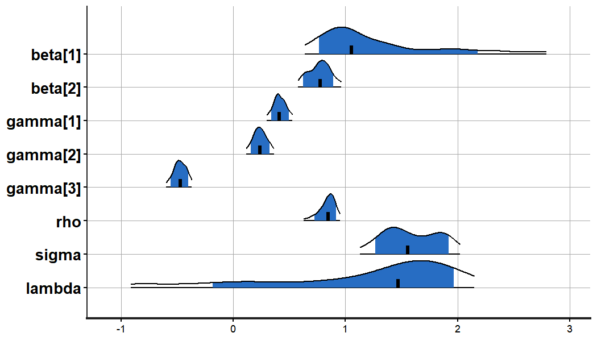
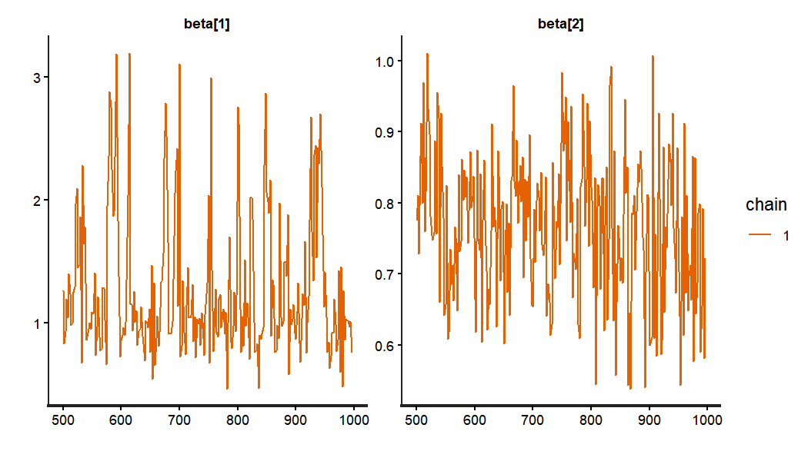
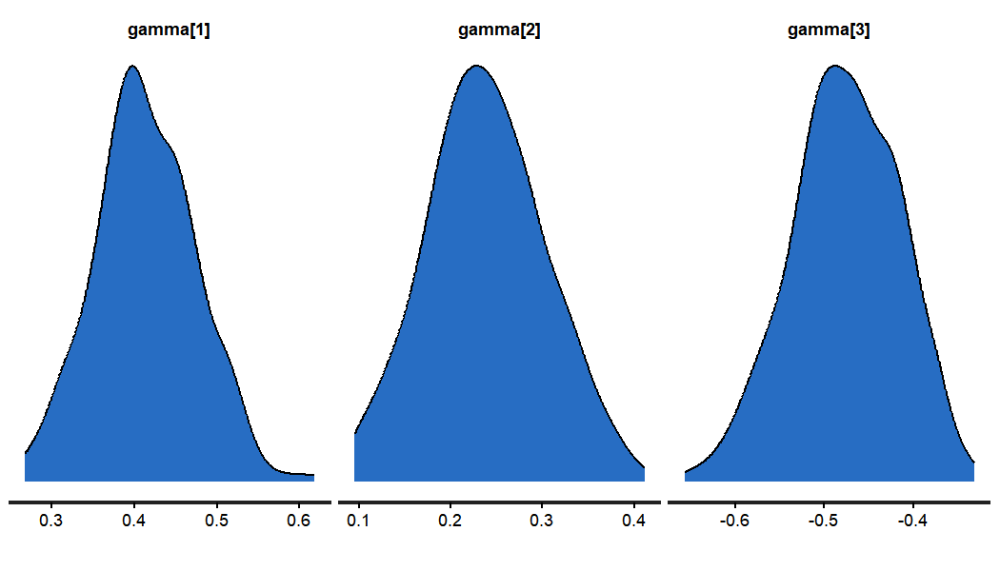

<!-- README.md is generated from README.Rmd. Please edit that file -->

# HeckmanStan

<!-- 로고가 생기면 위 제목을 아래 줄로 바꾸세요:
# HeckmanStan 
-->

<p align="center">

<a href="https://CRAN.R-project.org/package=HeckmanStan"></a>
<a href="https://CRAN.R-project.org/package=HeckmanStan"></a>
</p>

<p align="center">

<a href="https://CRAN.R-project.org/package=HeckmanStan"></a>
<a href="https://mc-stan.org"></a>
<a href="https://github.com/heeju-lim/HeckmanStan"></a>
</p>

**HeckmanStan** fits Heckman sample-selection models in a fully Bayesian
way with Hamiltonian Monte Carlo ([Stan](https://mc-stan.org)). Besides
the classical normal model, it offers three flexible error distributions
that cope with heavy tails, outliers and skewness:

| `family` | Error distribution | Extra parameters | Good for |
|:---|:---|:---|:---|
| `"Normal"` | Bivariate normal | – | Classical Heckman model |
| `"T"` | Student-*t* | `nu` | Heavy tails |
| `"CN"` | Contaminated normal | `nu1`, `nu2` | Outliers / contamination |
| `"SN"` | Skew-normal | `lambda` | Asymmetric (skewed) outcomes |

Every fit returns posterior means, standard deviations and 95% HPD
intervals, together with model-comparison criteria (**LOOIC**, **WAIC**,
**CPO**, **EAIC**, **EBIC**), so the families can be compared on the
same data.

## Installation

<p>

<a href="https://CRAN.R-project.org/package=HeckmanStan"></a>
<a href="https://github.com/heeju-lim/HeckmanStan"></a>
</p>

Released version from
[CRAN](https://CRAN.R-project.org/package=HeckmanStan):

``` r
install.packages("HeckmanStan")
```

Development version from
[GitHub](https://github.com/heeju-lim/HeckmanStan):

``` r
# install.packages("remotes")
remotes::install_github("heeju-lim/HeckmanStan")
```

## Main function: `HeckmanStan()`

``` r
fit <- HeckmanStan(y, x, w, cc, family = "SN",
                   init = "random", thin = 5, chains = 1,
                   iter = 10000, warmup = 1000)
```

| Argument | Description                                                   |
|:---------|:--------------------------------------------------------------|
| `y`      | Response vector (values for `cc == 0` are ignored).           |
| `x`      | Covariate matrix of the outcome equation.                     |
| `w`      | Covariate matrix of the selection equation.                   |
| `cc`     | Selection indicator (`1` = observed, `0` = missing).          |
| `family` | `"Normal"`, `"T"`, `"CN"` or `"SN"`.                          |
| `init`   | Initial values (`"random"` or a list, as in `rstan::stan()`). |
| `thin`   | Thinning interval of the MCMC draws.                          |
| `chains` | Number of Markov chains.                                      |
| `iter`   | Total iterations per chain (including warm-up).               |
| `warmup` | Warm-up (burn-in) iterations per chain.                       |

The returned object of class `"HeckmanStan"` contains

- `fit[[1]]` – the `stanfit` object: posterior summaries and convergence
  diagnostics (`n_eff`, `Rhat`) of all parameters.
- `fit[[2]]` – posterior mean, SD and 95% HPD interval of each parameter
  (`fit[[2]][[1]]`), and the model-selection criteria LOOIC, WAIC, CPO,
  EAIC and EBIC (`fit[[2]][[2]]`).

## Example 1: skewed data with selection

We simulate $n = 500$ units whose outcome error is **skew-normal**
($\lambda = 2$) and correlated with the selection error ($\rho = 0.6$).

``` r
library(HeckmanStan)
set.seed(2025)
n<- 100
w<- cbind(1,rnorm(n),rnorm(n))
x<- cbind(w[,1:2])
type="Normal"
sigma2<- 1
rho<-0.7
beta<- c(1,0.5)
gama<- c(1,0.3,-.5)
nu=c(0.1,0.1)
data<-geraHeckman(x,w,beta,gama,sigma2,rho,nu,family=type)
y<-data$y
cc<-data$cc
```

### Fit the skew-normal Heckman model

``` r
fit_sn <- HeckmanStan(y, x, w, cc, family = "SN",
                      thin = 2, chains = 1, iter = 1000, warmup = 500)
```

``` r
print(fit_sn[[1]], pars = c("beta", "gamma", "rho", "sigma", "lambda")) 
#> Inference for Stan model: anon_model.
#> 1 chains, each with iter=1000; warmup=500; thin=2; 
#> post-warmup draws per chain=250, total post-warmup draws=250.
#> 
#>           mean se_mean   sd  2.5%   25%   50%   75% 97.5% n_eff Rhat
#> beta[1]   1.28    0.07 0.58  0.64  0.90  1.05  1.45  2.79    73 1.00
#> beta[2]   0.77    0.01 0.10  0.58  0.69  0.77  0.84  0.96   116 1.01
#> gamma[1]  0.41    0.00 0.06  0.30  0.37  0.41  0.45  0.53   239 1.00
#> gamma[2]  0.24    0.00 0.06  0.11  0.19  0.24  0.28  0.36   220 1.01
#> gamma[3] -0.48    0.01 0.06 -0.60 -0.52 -0.47 -0.43 -0.37   139 1.00
#> rho       0.83    0.01 0.08  0.63  0.79  0.85  0.89  0.95   151 1.00
#> sigma     1.58    0.03 0.25  1.13  1.39  1.56  1.81  2.02    75 1.00
#> lambda    1.18    0.10 0.84 -0.91  0.81  1.48  1.76  2.15    66 1.00
#> 
#> Samples were drawn using NUTS(diag_e) at Tue Oct 13 17:33:28 2026.
#> For each parameter, n_eff is a crude measure of effective sample size,
#> and Rhat is the potential scale reduction factor on split chains (at 
#> convergence, Rhat=1).
fit_sn[[2]]
#> $estimates
#>           iterations
#> parameters       Mean         Sd HPD(95%) Lower HPD(95%) Upper
#>   beta[1]   1.2775543 0.57697912      0.4623054      2.6191898
#>   beta[2]   0.7666784 0.10255572      0.5816364      0.9657843
#>   gamma[1]  0.4134654 0.06092505      0.3068803      0.5300374
#>   gamma[2]  0.2381762 0.06358228      0.1263008      0.3734280
#>   gamma[3] -0.4757477 0.06026724     -0.5841455     -0.3651098
#>   rho       0.8319969 0.08360853      0.6778572      0.9769699
#>   sigma     1.5825977 0.25493232      1.1286024      2.0144353
#>   sigma2    2.5693459 0.81051716      1.2737434      4.0579497
#>   lambda    1.1796451 0.84080418     -0.8457989      2.1814585
#> 
#> $criteria
#>           EAIC     EBIC    LOOIC     WAIC       CPO
#> Value 1780.507 1814.223 1772.906 1772.736 -886.3456
```

The posterior recovers the true values ($\beta = (1, 0.5)$,
$\gamma = (0.5, 0.3, -0.5)$, $\rho = 0.6$, $\sigma = 1$, $\lambda = 2$).

### Diagnostics and plots

`fit$stanfit` is a regular `stanfit` object, so all **rstan** tools
work.

``` r
library(rstan)
qoi <- c("beta", "gamma", "rho", "sigma", "lambda")

stan_plot(fit_sn[[1]], pars = qoi, show_density = TRUE, fill_color = "#276DC3")
```



``` r
stan_trace(fit_sn[[1]], pars = c("beta"))
```



``` r
stan_dens(fit_sn[[1]], pars = c("gamma"), fill = "#276DC3")
```



## Citation

If you use **HeckmanStan**, please cite:

> Lim, H., Lachos, V. E., and Lachos, V. H. (2025). *Bayesian analysis
> of flexible Heckman selection models using Hamiltonian Monte Carlo.*
> arXiv:2510.20942. <https://doi.org/10.48550/arXiv.2510.20942>

For the classical (EM-based) contaminated-normal Heckman model:

> Lim, H., Ordoñez, J. A., Punzo, A., and Lachos, V. H. (2025). Heckman
> selection contaminated normal model. *Journal of Computational and
> Graphical Statistics.* <https://doi.org/10.1080/10618600.2025.2576165>

``` bibtex
@article{lim2025bayesheckman,
  title   = {Bayesian analysis of flexible Heckman selection models using Hamiltonian Monte Carlo},
  author  = {Lim, Heeju and Lachos, Victor E. and Lachos, Victor H.},
  journal = {arXiv preprint arXiv:2510.20942},
  year    = {2025},
  doi     = {10.48550/arXiv.2510.20942}
}
```
